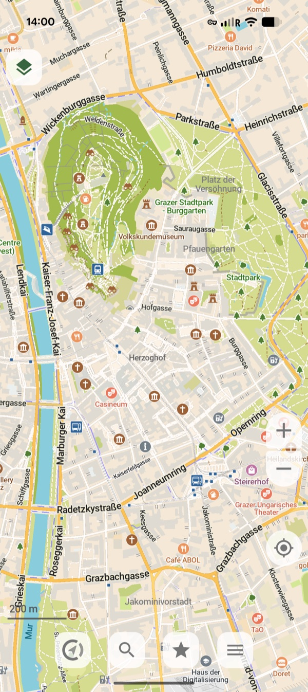
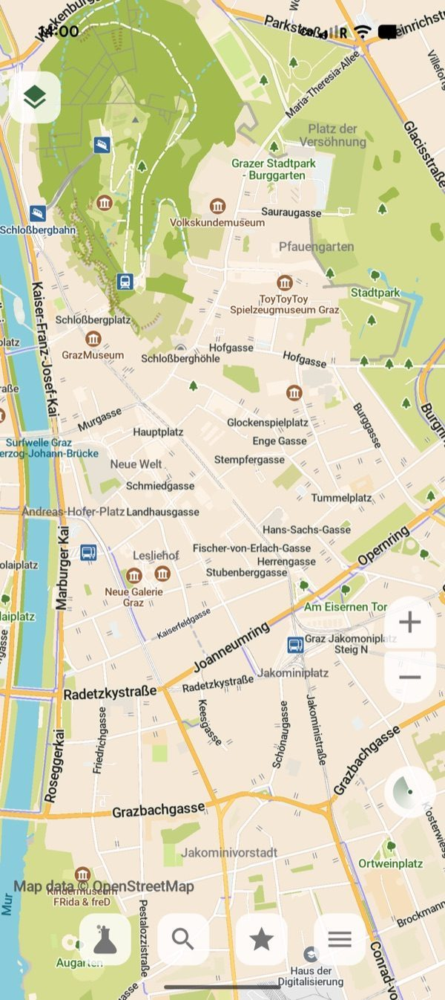
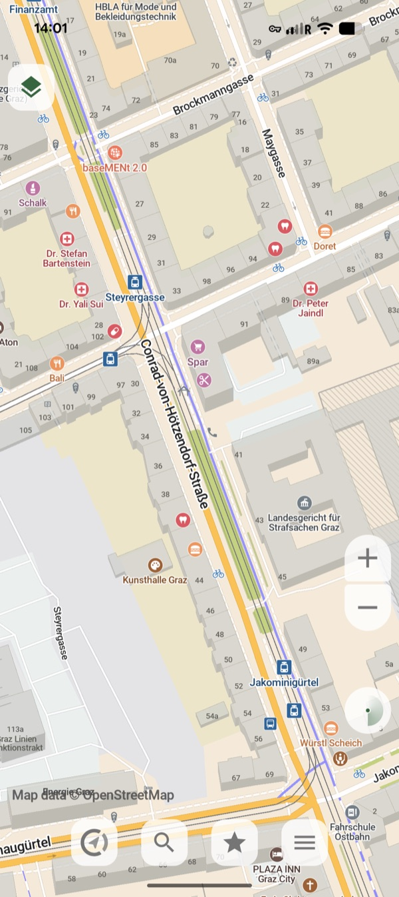
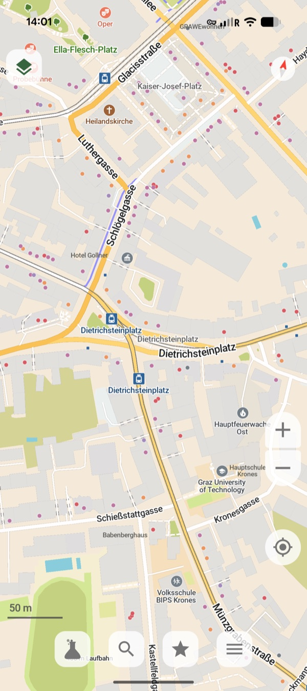
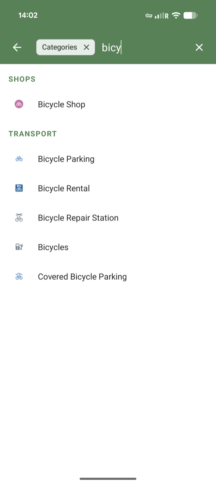

# Sandbox Maps

Sandbox Maps is an experimental fork of [CoMaps](https://codeberg.org/comaps/comaps),
a free, offline, privacy-focused maps app for Android, iOS and Linux built on
[OpenStreetMap](https://www.openstreetmap.org) data.

## About this fork

This fork exists just for experimenting with ideas, including ones built with
AI generated or assisted code. Please use it only at your own risk, since it
might not be stable or reliable for navigation. It's mostly a just-for-fun
experiment to see how it evolves from here.

Sandbox Maps is not affiliated with, endorsed by, or supported by the CoMaps project.
Please don't report Sandbox Maps issues to CoMaps, and don't expect the two to stay
in sync.

## What's different from CoMaps

**Map style**

- Buildings are lighter in colour, and 3D buildings are held back until zoom 18,
  including in isometric view, for a lighter overview and smoother transitions.
- Some colours, like the motorway orange, are softer.
- Address numbers and similar details only appear from zoom 20, which declutters
  the map considerably.
- POIs appear at retuned zooms (dense POIs, bus stops, areas), and sidewalks and
  similar details only from zoom 20.
- Dots replace some icons when they are too crowded.

<table>
  <tr>
    <th>CoMaps</th>
    <th>Sandbox Maps</th>
  </tr>
  <tr>
    <td></td>
    <td></td>
  </tr>
  <!-- TODO: replace with the same street and zoom in both apps -->
  <tr>
    <td></td>
    <td></td>
  </tr>
</table>

**Position marker:** a lighter blue arrow, plus a dot with a heading cone while you
browse the map without navigating.

**Search (Android)**

- One start screen with a category mode for easier discovery, including a Random
  option.
- A dynamic search history that keeps places you have interacted with, such as ones you navigated to, within easy reach. Everything is stored privately on the device.
- Map icons in results, backed by about 70 new search result icons and a fallback to the parent type's icon.

## Building

See [INSTALL.md](INSTALL.md) for build instructions, which are unchanged from
upstream.

## Contributing

This fork is not open to contributions for now. Please contribute upstream to
[CoMaps](https://codeberg.org/comaps/comaps) instead.

## License

Licensed under the Apache License 2.0.
See [LICENSE](LICENSE), [NOTICE](NOTICE), and [data/copyright.html](data/copyright.html).

Sandbox Maps is derived from CoMaps, which is derived from
[Organic Maps](https://github.com/organicmaps/organicmaps), itself derived from
[MAPS.ME](https://github.com/mapsme/omim).
